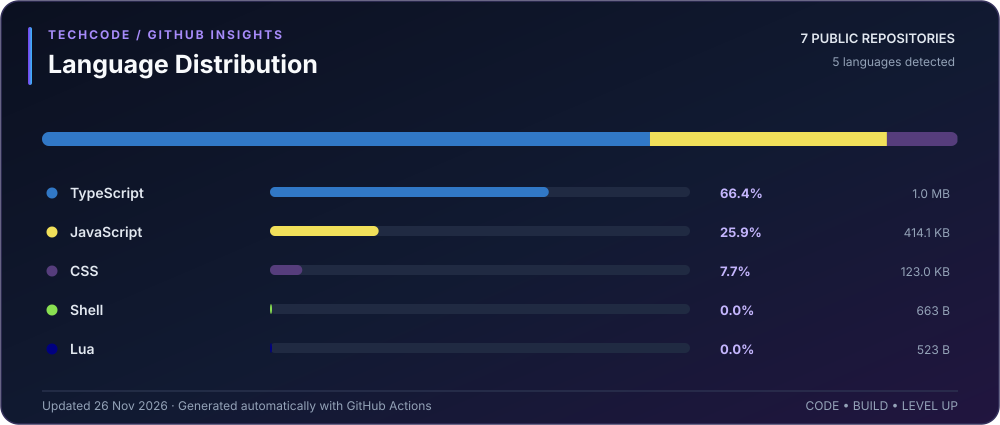

<!-- ==================== TECHCODE PROFILE README ==================== -->

  

<h1 align="center">Hi, I'm Mohammad Afrouzeh 👋</h1><h3 align="center">Full-Stack Developer | Backend & API Engineering</h3>

  Building software, engineering systems, and turning ideas into reality.

  
  
  

I'm a Full-Stack Developer passionate about backend engineering, software architecture, and building reliable applications.

I enjoy designing modular systems, developing APIs, working with databases, and solving real-world engineering challenges.
- 💻 Focused on Full-Stack and Backend Development
- ⚙️ Interested in modular architecture and worker-based systems
- 🚀 Building applications with TypeScript, Node.js, and modern technologies
- 🧠 Continuously learning and improving my engineering skills
- 🌐 Exploring new ideas and turning them into practical software
My philosophy: Write clean code. Build meaningful things. Keep improving.

Languages & Runtime

  

Frontend Development

  

Backend & Databases

  

DevOps & Tools

  

  

  Automatically generated from the language data of my public, non-fork repositories and refreshed daily.

  I'm always interested in technology, software engineering, and meaningful collaborations.

  <a href="https://mohammadafrouzeh.ir">🌐 Portfolio</a>
  &nbsp; • &nbsp;
  <a href="https://www.linkedin.com/in/mohammad-afrouzeh">LinkedIn</a>
  &nbsp; • &nbsp;
  <a href="mailto:mafrwzh4@gmail.com">Email</a>

  <strong>Code • Build • Level Up</strong>
   
  Built with passion by Mohammad Afrouzeh | TECHCODE

<!-- ==================== END OF README ==================== -->
